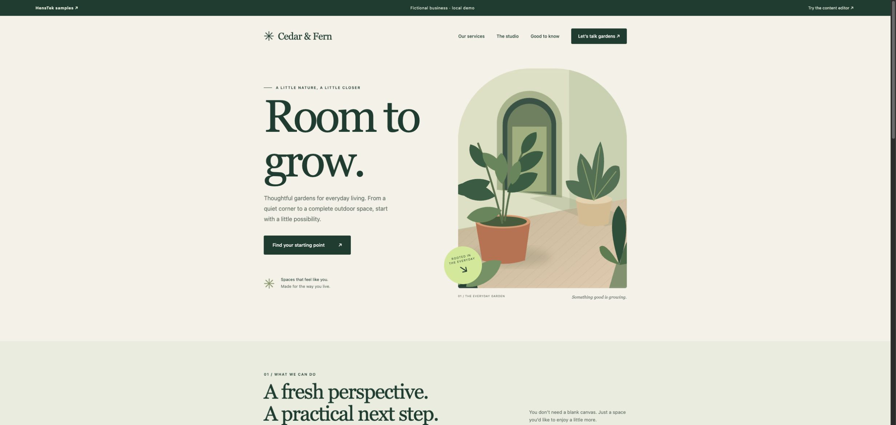

# HensTek Sample Set 01 — Cedar & Fern

Working examples you can explore, run and adapt. **Sample Set 01 — Cedar & Fern** is the first set: a fictional garden studio across an independent service website, iPhone visit planner and desktop job board.

[Sample Set 01 guide](sets/set-01/README.md) · [Set index and naming](sets/README.md)

Future alternate designs will have their own numbered repositories, listed at [HensTek’s sample gallery](https://henstek.dev/samples). The set number identifies the scenario and design; source revisions are tracked separately by Git commit.

[Explore the collection](https://recondemon.github.io/henstek-sample-set-01/) · [Discuss a commissioned build](https://henstek.dev/start?sample=set-01)

| Sample | What you can try | Source and setup |
| --- | --- | --- |
| **Cedar & Fern website** | Responsive service site, content preview/save/undo, JSON content import/export, inquiry review | [Website guide](samples/website/README.md) · [Live demo](https://recondemon.github.io/henstek-sample-set-01/web/) |
| **Field Notes for iPhone** | Visits, checklist, notes, completion, local persistence, JSON import/export | [iPhone guide](samples/mobile/README.md) |
| **Studio Board for desktop** | Jobs, search, status filters, editing, local file storage, portable exports | [Desktop guide](samples/desktop/README.md) · [Browser preview](https://recondemon.github.io/henstek-sample-set-01/desktop/) |

These examples demonstrate interface design, state management, validation, persistence, recovery and handoff. Each can be used on its own; they do **not** sync with each other. All records are fictional. There are no connected customer accounts, payments, messages or cloud databases.



## Run the website and browser previews

Use Node.js **22.12 or newer** (a current LTS release is recommended).

```sh
git clone https://github.com/recondemon/henstek-sample-set-01.git
cd henstek-sample-set-01
npm ci
npm run dev
```

Open `http://127.0.0.1:4325`. No runtime dependencies, API keys or account setup are needed for the browser demos. `npm run build` refreshes the generated `docs/` directory after edits; the local server serves those files. It does not watch source files.

The iPhone app needs macOS and Xcode. The desktop app has its own dependency install; see its guide.

## Reuse and customize

Start with the sample closest to your workflow, change its fictional branding and example records, and add only the integrations you need. The code and original courtyard illustration are [MIT licensed](LICENSE); keep the copyright and license notice when redistributing. Third-party dependencies retain their own licenses. The license does not grant an endorsement or permission to present HensTek as your business.

For a commissioned version, we agree the deliverables, publishing/editing access, data handling, hosting, integrations, support and handoff before work begins. [The sample walkthrough](CUSTOMER-WALKTHROUGH.md) explains the choices a client can make. A public example is not a fixed-price quote or a claim that a production integration is included.

## Verify changes

```sh
npm run build
npm test
npm run test:mobile   # macOS + Swift
```

The Node suite checks content and inquiry validation, import rejection, desktop persistence, previous-revision recovery and public asset paths. The Swift checks exercise archive validation, round trips, saved changes and preservation of damaged files. See [verification details](VERIFICATION.md) for platform checks and limits.

## Repository layout

- `sets/` — numbered set guides and catalog conventions
- `samples/website/` — original website source and illustration
- `samples/mobile/` — SwiftUI iPhone project, no external packages
- `samples/desktop/` — Electron app and shared browser renderer
- `public/` — collection landing page
- `scripts/` — dependency-free build and local server
- `docs/` — generated GitHub Pages site; edit source then rebuild
- `fixtures/` — fictional import files for all three samples
- `tests/` — data and recovery checks

Contributions: [CONTRIBUTING.md](CONTRIBUTING.md). Security reports: [SECURITY.md](SECURITY.md).
